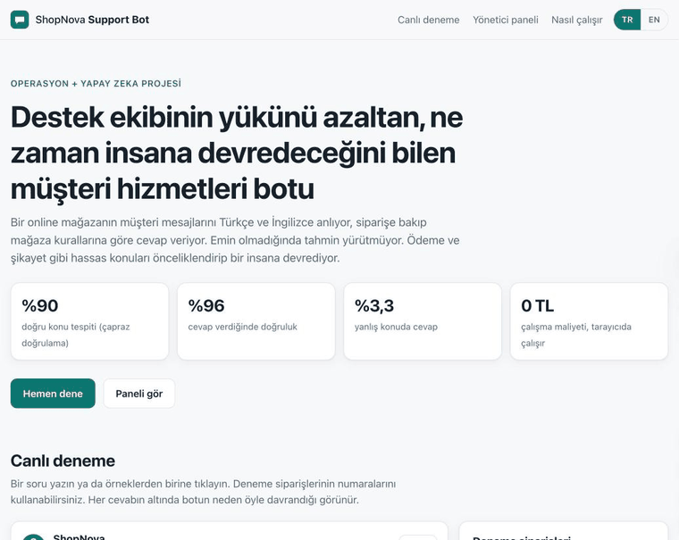

# ShopNova Support Bot

[](https://github.com/ahmetberademirr-dev/ai-customer-service-bot/actions/workflows/tests.yml)

**A bilingual (Turkish / English) customer service bot for an online store that cuts the support team's workload and knows when to hand over to a human.**

**▶ Live demo: [ahmetberademirr-dev.github.io/ai-customer-service-bot](https://ahmetberademirr-dev.github.io/ai-customer-service-bot/)** (chat with the bot, see the team-lead dashboard; add `?lang=en` for English)



## The problem

Most messages a store's support team gets are repetitive: *where is my order, can I cancel, how do I return this*. Agents spend their time on these while urgent cases (double charges, late deliveries, angry customers) wait in the same queue.

## What the bot does

| Step | What happens |
|---|---|
| **1. Understand** | Detects the language and one of 10 topics, with a confidence score. |
| **2. Check** | Finds the order number (in the message or earlier in the chat), looks the order up and applies store rules: shipped orders can't be cancelled, returns are open for 14 days, the address can only change before shipping. |
| **3. Decide** | Answers on its own, asks for missing information, or hands over to a human, and sets a priority. |
| **4. Log** | Every message is stored with topic, confidence, decision and priority, which feeds the team-lead dashboard (automation rate, human queue, top topics, time saved). |

### Design decisions

- **Money is never automated.** Every payment issue goes to the billing team with high priority.
- **It doesn't guess.** Below 40% confidence it asks the customer to rephrase. A wrong answer costs more than a second question.
- **No loops.** Two misunderstandings in a row and the conversation goes to a human.
- **Urgent first.** Late orders, payment issues and angry wording ("rezalet", "urgent", "scam"…) get high priority.
- **Zero cost, zero data sharing.** No paid AI API. The demo runs entirely in the visitor's browser.

## How well it works

Measured with `python evaluate.py` ([full report](reports/evaluation.md)):

| | 120 unseen test questions | 5-fold cross-validation (690) |
|---|---|---|
| Correct topic | 100.0% | **90.4%** |
| Answers on its own | 96.7% | 83.3% |
| Correct when it answers | 100.0% | **96.0%** |
| Answers on the wrong topic | 0.0% | **3.3%** |
| Asks the customer to rephrase | 3.3% | 16.7% |

Language detection: 100% on the test set. The test set was written by hand and is easier than real traffic, so the **cross-validation column is the honest estimate**.

## How it's built

- **Model:** TF-IDF features (word 1–2 grams + character 2–5 grams, so Turkish suffixes and typos like *siparisim / siparişimi* match) and logistic regression, trained with scikit-learn on 690 hand-written Turkish and English examples.
- **Rules + data:** demo orders in SQLite, store rules in [`src/bot.py`](src/bot.py), reply templates in [`data/replies.json`](data/replies.json).
- **Browser demo:** [`export_model.py`](export_model.py) exports the trained weights to JSON, and [`docs/bot.js`](docs/bot.js) re-implements the same feature extraction and rules in JavaScript. A parity test proves the browser bot gives **the same topic and language as Python on all 810 sentences** and passes the same 22 conversation scenarios.
- **Tests:** conversation scenarios live in [`tests/scenarios.json`](tests/scenarios.json) and run against both versions on every push (GitHub Actions).

```text
data/            training + test questions, demo orders, reply templates
src/             classifier.py (models), bot.py (conversation + store rules), database.py (SQLite log + metrics)
docs/            the live demo page (GitHub Pages): bot.js, app.js, model.json, data.json, metrics.json
tests/           scenarios.json, Python tests, browser parity test (parity.mjs)
evaluate.py      accuracy report -> reports/evaluation.md + docs/metrics.json
export_model.py  Python model -> docs/model.json for the browser
main.py          chat with the bot in the terminal
```

## Run it locally

Python 3.9–3.12 (Node.js 18+ optional, for the parity test):

```bash
git clone https://github.com/ahmetberademirr-dev/ai-customer-service-bot.git
cd ai-customer-service-bot
pip install -r requirements.txt

python main.py --demo          # scripted Turkish + English conversation
python main.py                 # chat with it (demo orders: 100231, 100245, 100262, 100278, 100290, 100301)
python -m unittest discover tests
python evaluate.py

# after changing anything in data/ or src/:
python export_model.py
python -m http.server -d docs  # open http://localhost:8000
```

## Limits

- Topics and order data are a demo store's, not a real company's. A real deployment would plug into the store's order system and a live-chat tool.
- 690 training sentences is small; real conversation logs would improve accuracy, especially for mixed or very short messages.
- Replies are templates, not generated text. That is deliberate: every answer is predictable and checkable.

## Author

**Ahmet Bera Demir**, Management Engineering, Istanbul Technical University (ITU) · [LinkedIn](https://www.linkedin.com/in/ahmet-bera-demir-345857299/)

Design, business rules and evaluation by Ahmet. Code written with AI assistance (Claude Code).
